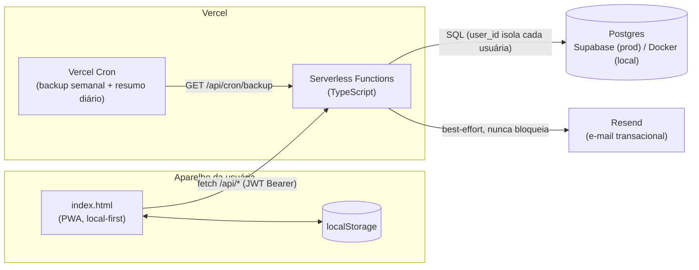

# MyDay

PWA de agenda de atendimentos para profissionais de saúde (fonoaudiologia, fisioterapia, psicologia etc.) que atendem em clínicas e/ou particular. Front é HTML + CSS + JS puro, sem build — tudo em `index.html`. Tem uma API própria em TypeScript (Vercel Serverless Functions) com Postgres, pra sincronizar entre aparelhos sem depender só do navegador.

## Arquitetura



O app é **local-first**: toda leitura e escrita acontece primeiro no `localStorage` (a tela nunca espera a rede), e a sincronização com a API roda em segundo plano, com debounce, só quando há sessão (`AUTH` setado). Sem conta, o app funciona 100% offline — é assim que o modo "Ver com exemplos" funciona, e é o motivo de dar pra usar no consultório mesmo com internet ruim.

**Decisões que valem explicar:**

- **IDs gerados no cliente + upsert no servidor.** Cada registro novo já nasce com um UUID (`crypto.randomUUID()`), tanto local quanto depois de sincronizado. O backend faz `insert ... on conflict (id) do update`, então reenviar o mesmo registro (reconectar depois de ficar offline, por exemplo) nunca duplica nada — a sincronização é idempotente.
- **Autenticação sem sessão.** Login devolve um JWT (válido por 30 dias) que o front guarda e manda em cada chamada; não existe tabela de sessões nem cookie. Mais simples de operar, ao custo de não dar pra "derrubar" uma sessão específica — `getAuth` só verifica a assinatura do token, não consulta o banco, então trocar a senha **não** invalida tokens já emitidos (eles continuam válidos até expirar). É uma limitação conhecida, documentada aqui pra não ser redescoberta depois; mitigada só pelo prazo curto, não por revogação de verdade.
- **`?id=` em vez de rota dinâmica.** O plano Hobby da Vercel limita a 12 Serverless Functions por deployment. Um `index.ts` por recurso (places, patients, appts...) resolve lista/criação/leitura/atualização/exclusão lendo o id da query string, em vez de dois arquivos por recurso — mantém a API num desenho RESTful sem estourar o limite. Hoje o projeto está exatamente em 12/12; qualquer endpoint novo precisa reaproveitar um arquivo existente (como foi feito com a troca de senha, pendurada em `PUT /api/auth/me?action=password`) ou remover algo.
- **Backup automático na própria tabela.** Em vez de um serviço de storage externo (mais uma credencial pra gerenciar), uma Vercel Cron semanal (toda sexta às 22h, horário de Brasília) salva um dump JSON na tabela `backups` do próprio Postgres e apaga além das últimas 8 cópias (~2 meses de histórico). Simples de operar, e o volume de dados de um app deste tamanho não justifica mais que isso. A conta admin também pode disparar um backup manualmente e baixar qualquer cópia guardada direto pelo painel (Ajustes › Geral).
- **Conta admin gerencia tudo pelo app, sem SQL.** Não existe mais cadastro público: só uma conta com `role='admin'` cria/edita contas de cliente, ajusta prazo de acesso, reseta senha esquecida e acompanha métricas/logs/feedback — tudo pela própria interface (painel "Ajustes" dessa conta, com abas Geral/Clientes/Feedback/Logs/Conta). Só a primeira conta admin precisa ser inserida direto no banco (`insert into users ... role='admin'`), ver seção **Criando a primeira conta admin** abaixo.
- **Personalização sem build.** Cor de destaque e ícone do app (Ajustes › Aparência) são resolvidos só com CSS custom properties (`--accent`, recalculado via `color-mix()`) e troca de elementos `<link>` em tempo real — incluindo o `manifest.json`, que é reconstruído na hora como um `Blob` com a URL certa dos ícones, já que é um arquivo estático e não dá pra personalizar por usuária no servidor sem complicar a infraestrutura.
- **Separação local × produção** é tratada como regra de segurança, não só de conveniência — ver a seção dedicada mais abaixo.

## Rodando localmente

Pra só olhar o front-end (sem login, sincronização ou painel admin — fica no modo "Ver com exemplos"):

```bash
npx serve .
```

Pra rodar tudo de verdade, inclusive login/sincronização/admin, use `npm run dev:api` (ver **Backend** abaixo) — ele já sobe o front e a API juntos em `http://localhost:3000`.

Para testar como PWA no iPhone, acesse pelo Safari e use "Adicionar à Tela de Início".

> Não abra `index.html` direto com `file://` para testar o service worker — ele só funciona servido por `http://` ou `https://`.

## Publicando

O projeto é um site estático (sem servidor). Qualquer host estático serve (Vercel, Netlify, GitHub Pages...).

Publicado na Vercel em **https://minha-agenda-coral.vercel.app**, conectado ao repositório no GitHub: todo `git push` para `master` dispara um deploy automático de produção. Não é mais necessário rodar `vercel` manualmente.

## Testes

Três camadas, rodando contra código e banco reais (nada mockado além do estritamente necessário):

- **Unitários** (Vitest) — `lib/*` isolado: mapeamento de linhas do Postgres, JWT, tokens aleatórios, parsing de IP, templates de e-mail (inclusive que escapam HTML), log de eventos.
- **Integração** (Vitest + API real + Postgres local) — login, isolamento de dados entre contas (inclusive o upsert `on conflict` cross-tenant), feedback, reset de senha pela admin, edição de cliente, backup manual/lista/download. Exige `npm run dev:api` rodando numa aba e o Docker ligado.
- **End-to-end** (Playwright) — fluxo principal no modo "Ver com exemplos" (agendar com convênio novo, editar horário, gerar relatório semanal) e falha se aparecer qualquer erro no console. Viewport simula um iPhone 13 (390×844).

```bash
npm install
npx playwright install webkit

npm run typecheck        # tipos, sem gerar build
npm run test:unit        # Vitest, só lib/* — não precisa de banco nem API no ar
npm run test:integration # Vitest, precisa de `npm run dev:api` rodando
npm test                 # Playwright (e2e)
npm run test:all         # os quatro em sequência
```

## Estrutura

- `index.html` — app inteiro (HTML + CSS + JS)
- `manifest.json` — manifesto do PWA
- `sw.js` — service worker (cache network-first); **incremente a constante `C` a cada deploy** para invalidar o cache dos usuários
- `icon-180/192/512.png` — ícones do app
- `api/` — backend em TypeScript (Vercel serverless functions), ver abaixo
- `lib/` — código compartilhado do backend (conexão com o banco, autenticação, rate limit, e-mail, log de eventos)
- `scripts/local-server.ts` — servidor HTTP próprio (sem Vercel CLI) que serve o front e roda os mesmos handlers de `api/**` localmente, usado por `npm run dev:api`
- `supabase/schema.sql` — schema do Postgres (usado tanto pelo Docker local quanto pelo Supabase de produção)
- `docker-compose.yml` — Postgres local para desenvolvimento (`npm run db:up`)
- `tests/unit/`, `tests/integration/` — Vitest; `tests/*.spec.js` — Playwright (e2e)

## Dados

Tudo fica salvo no `localStorage` do navegador, na chave `minha-agenda-v1` — é a cópia que o app realmente usa pra renderizar a tela (local-first, ver arquitetura acima). Não há cadastro público: a conta admin cria a conta da profissional (e-mail + senha padrão) e ela entra com isso, trocando a senha no primeiro acesso — dados sincronizam na nuvem entre aparelhos a partir daí. Sem conta, o onboarding só oferece o modo "Ver com exemplos" (100% local, nada sincroniza).

## Backend

API em TypeScript rodando como Vercel Serverless Functions, usando o Supabase só como Postgres gerenciado (sem Supabase Auth/RLS — autenticação e isolamento por usuária são feitos pela própria API).

### Ambientes: local × produção (nunca se misturam)

| | Local (desenvolvimento) | Produção |
|---|---|---|
| Banco | Postgres no Docker, só na sua máquina | Supabase (nuvem) |
| Variáveis | `.env` (não commitado) | Vercel → Settings → Environment Variables |
| Dados | só os seus testes | dados reais das usuárias |

O banco local e o de produção **não têm nenhuma comunicação entre si**. Rodar `npm run dev:api` na sua máquina nunca deve tocar no banco de produção — se `DATABASE_URL` estiver apontando pro Supabase, está configurado errado. A conexão escolhe SSL automaticamente pelo host (desligado para `localhost`, ligado — e com certificado verificado — para qualquer outro); localmente isso não muda nada, já que o Postgres do Docker nunca passa por esse caminho.

**Antes de confiar nisso em produção:** faça um deploy de *preview* da Vercel (qualquer branch que não seja `master`, com `DATABASE_URL` e `JWT_SECRET` de produção já configurados nas variáveis de ambiente — a própria Vercel usa as de Production em branches sem override, a menos que você configure Preview separado) e confirme que login/API respondem normalmente nessa URL de preview antes de dar merge. Se a conexão falhar, o sintoma é só erro 500 ("não consegui conectar"), nunca perda ou corrupção de dado — o Postgres continua intacto, só ninguém consegue falar com ele até reverter ou ajustar `DATABASE_CA_CERT`.

**Configuração local (uma vez):**

1. Tenha o [Docker Desktop](https://www.docker.com/products/docker-desktop/) instalado e aberto.
2. Copie `.env.example` para `.env` (os valores padrão já apontam para o banco local — não precisa editar nada pra começar). `scripts/local-server.ts` e os testes de integração leem esse `.env` diretamente — nada de `vercel login`/`vercel link` é necessário pra desenvolver local.
3. `npm install`
4. `npm run dev:api` — um script (`scripts/dev.js`) sobe o Postgres local no Docker automaticamente (esperando ficar saudável), aplica `supabase/schema.sql` sozinho na primeira vez (volume vazio), e só depois inicia `scripts/local-server.ts` (via `tsx watch`, com hot-reload) — um servidor HTTP próprio que reaproveita os mesmos arquivos de `api/**` sem precisar da Vercel CLI. Abre em `http://localhost:3000`. Ao encerrar (Ctrl+C), o container é parado também.
5. `npm run typecheck` — confere os tipos sem gerar build.

Se mudar o schema (`supabase/schema.sql`) depois de já ter subido o banco uma vez, rode `npm run db:reset` para recriar o volume do zero com o schema novo (isso apaga os dados locais de teste — é só o banco de desenvolvimento).

**Deploy real (produção) continua sendo só `git push` para `master`** — a Vercel builda e publica a partir de `api/**` normalmente; `scripts/local-server.ts` é usado só em desenvolvimento, nunca em produção.

### Criando a primeira conta admin

Não existe cadastro público nem tela para isso — é proposital (só uma conta admin pode criar contas de cliente). A primeira precisa ser inserida direto no banco, uma única vez:

```bash
# 1. Gere o hash da senha escolhida
node -e "console.log(require('bcryptjs').hashSync('SUA_SENHA_AQUI', 10))"

# 2. Insira a conta (local: psql via Docker; produção: SQL Editor da Supabase)
docker exec -it minha-agenda-db psql -U postgres -d minha_agenda -c "insert into users (email, password_hash, name, role, access_type, email_verified_at) values ('seu-email@exemplo.com', 'COLE_O_HASH_AQUI', 'Seu Nome', 'admin', 'unlimited', now());"
```

Depois disso, logue normalmente no app com esse e-mail/senha — a conta entra direto na área de gestão (Ajustes com abas Geral/Clientes/Feedback/Logs/Conta), sem ver Agenda/Pacientes/Relatórios (essas ficam reservadas pra contas de cliente).

**Configuração de produção (feita uma vez, pelo quem administra o projeto):**

1. Crie um projeto no [supabase.com](https://supabase.com) (free tier, região São Paulo — `sa-east-1`).
2. Em *SQL Editor*, rode o conteúdo de `supabase/schema.sql`.
3. Em *Project Settings → Database → Connection string*, copie a opção **Transaction pooler** (não a "URI" direta — ela só resolve por IPv6 e a Vercel não tem saída IPv6, dá `ENOTFOUND`).
4. Cadastre `DATABASE_URL` (com a senha do banco) e `JWT_SECRET` (uma string longa aleatória, diferente da usada em local) em Vercel → Settings → Environment Variables → **Production** (e Preview, se quiser deploys de preview funcionais). Nunca cole esses valores em nenhum arquivo do repositório.

**Endpoints prontos até agora** (todos sob `/api`; os de CRUD usam `?id=` em vez de segmento de rota, porque o plano Hobby da Vercel limita a 12 Serverless Functions por deployment — um `index.ts` por recurso cuida de lista/criação/leitura/atualização/exclusão em vez de dois arquivos por recurso):

- `GET /api/health` — ping
- `POST /api/auth/signup` — **só a conta admin** (header `Authorization: Bearer <token-admin>`), body `{ email, name, title?, accessType, accessUntil? }` → cria uma conta de cliente com senha padrão (`mudar@123`, `DEFAULT_PASSWORD` em `lib/auth.ts`) e `mustChangePassword=true`. Não existe cadastro público.
- `POST /api/auth/login` — `{ email, password }` → `{ token }` (bloqueia se `access_until` da conta já passou, exceto admin/ilimitado)
- `GET /api/auth/me` — header `Authorization: Bearer <token>` → dados da usuária logada, incluindo `emailVerified`, `role`, `accessType`/`accessUntil`, `mustChangePassword`
- `GET /api/auth/verify?token=<token>` — confirma o e-mail (link do e-mail; retorna HTML, não JSON)
- `POST /api/auth/verify` — reenvia o e-mail de confirmação
- `POST /api/auth/verify?action=forgot` — `{ email }` → sempre responde igual, exista ou não a conta (evita enumeração); envia e-mail com link de redefinição
- `POST /api/auth/verify?action=reset` — `{ token, newPassword }` → troca a senha a partir do link do e-mail
- `PUT`/`PATCH /api/auth/me` — body `{ name?, title?, regNumber?, signature? }` → atualiza o perfil
- `PUT`/`PATCH /api/auth/me?action=password` — `{ currentPassword, newPassword }` → troca a própria senha
- `PUT`/`PATCH /api/auth/me?action=feedback` — `{ message }` → grava o feedback em `admin_logs` (aparece na aba Feedback do painel admin, além do e-mail que o front já dispara em paralelo)
- `PUT`/`PATCH /api/auth/me?action=push-subscribe` / `DELETE ?action=push-unsubscribe` — inscrição de notificação push deste aparelho
- **Só admin** — `GET ?action=admin-list` (lista clientes), `GET ?action=admin-logs` (métricas, logs paginados `&logsOffset=&logsLimit=`, feedbacks, atividade por conta, contas vencendo, status dos crons, crescimento mensal), `PUT ?action=admin-update` (nome/e-mail/prazo de acesso), `PUT ?action=admin-reset-password` (volta pra senha padrão), `DELETE ?action=admin-delete&userId=`
- `places`, `patients`, `appts`, `insurers`, `exceptions`, `records` — todos com o mesmo padrão, exigindo `Authorization: Bearer <token>` e isolados por `user_id`:
  - `GET /api/{recurso}` — lista (appts e exceptions aceitam `?from=YYYY-MM-DD&to=YYYY-MM-DD`; appts também aceita `?placeId=`; records aceita `?patientId=`)
  - `GET /api/{recurso}?id=<id>` — um item
  - `POST /api/{recurso}` — cria (upsert por `id`, se enviado; bloqueado se o `id` já pertencer a outra conta)
  - `PUT` ou `PATCH /api/{recurso}?id=<id>` — atualiza (campos parciais)
  - `DELETE /api/{recurso}?id=<id>` — remove
- `GET/POST /api/cron/backup` — reaproveita este arquivo pros dois cron jobs e pras ações de admin (o plano Hobby da Vercel já está no limite de 12 functions):
  - chamado automaticamente pela Vercel Cron (backup toda sexta 22h BRT; `?job=digest` todo dia, resumo por push) — identificado por header interno, não precisa de token
  - `POST` **por uma conta admin** — dispara o backup na hora ("Rodar backup agora" no painel)
  - `GET ?action=list` **admin** — lista os backups guardados (data, tamanho)
  - `GET ?action=download&id=<id>` **admin** — baixa o conteúdo de um backup como JSON

**E-mail transacional:** usa [Resend](https://resend.com) (free tier). Sem `RESEND_API_KEY` configurada, o envio só fica registrado no log — não trava nada, então não é obrigatório para rodar local. Para testar de verdade: crie uma conta no Resend, pegue a API key, e configure `RESEND_API_KEY` (local: `.env`; produção: Vercel). `APP_URL` é usada para montar o link do e-mail (local já vem certo por padrão; em produção, configure como `https://minha-agenda-coral.vercel.app`).

**Backup automático do banco:** a Vercel Cron chama `/api/cron/backup` 1x por semana (sexta-feira às 22h, horário de Brasília), que salva um dump de todas as tabelas como uma linha JSON na própria tabela `backups` e apaga cópias além das últimas 8 (~2 meses), pra nunca crescer sem limite. É uma rede de segurança a nível de banco — separado do botão "Salvar cópia agora" em Ajustes, que é a cópia local (JSON) que a própria usuária guarda no celular/nuvem pessoal, e também separado da cópia manual que a admin pode disparar/baixar pelo painel a qualquer momento.

**Observabilidade:** eventos relevantes (login, erro não tratado, conta criada, senha resetada, falha de rotina automática, feedback) são gravados na tabela `admin_logs` via `lib/adminLog.ts` — exibidos no painel admin (aba Logs, paginada, e o sino de notificação, que também soma itens não lidos/limpos guardados no aparelho da admin). `lib/withErrorLog.ts` envolve os handlers que não usam `withAuth` pra capturar erro não tratado do mesmo jeito.

**Testar a restauração do backup:** `npm run db:restore-drill` (só contra o banco local — recusa rodar se `DATABASE_URL` parecer apontar pra produção/Supabase). Gera um snapshot igual ao cron faria, grava na tabela `backups`, restaura num banco temporário à parte (recriando o schema do zero + reinserindo os dados) e confere se as contagens batem, depois apaga tudo que criou. Backup que nunca foi restaurado é só uma esperança — vale rodar de vez em quando pra confirmar que o dump continua restaurável.

Nunca commite `.env` nem `.env.local` — já estão no `.gitignore`.
